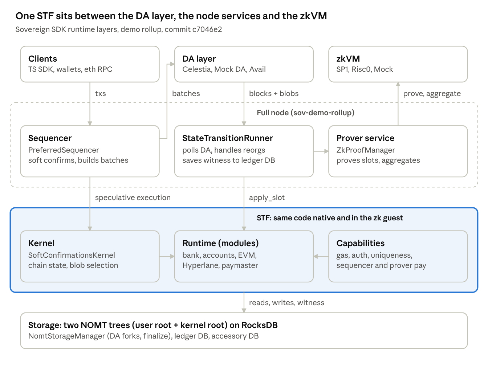

# Sovereign SDK — Architecture Breakdown

Nov 2, 2026 · @Vuthy · Live version: https://claude.ai/artifact/Fzwk94GDbWqqh8hJrjbqyf

## Overview

The Sovereign SDK is a Rust toolkit for building app-specific rollups. It splits a chain into four swappable parts: a **DA layer**, a **zkVM**, a **state transition function (STF)** made of modules, and a **full node / sequencer** that runs them. This breakdown covers [sovereign-labs/sovereign-sdk](https://github.com/sovereign-labs/sovereign-sdk) at commit `c7046e2` (30 Oct 2026).

**Method.** The analysis combined [REA](https://github.com/morluto/rea) (`rea-agents` CLI) with a direct read of the Rust source.

- REA `analyze-javascript-application` ran statically over `typescript/`: 156 relevant files, 113 parsed, 799 module nodes, 758 import edges, 0 integrity contradictions. It recovered the client package graph and the REST endpoints the clients call.
- REA's Rust path (`inspect-rust-binary`) needs a compiled `sov-demo-rollup` built with `cargo auditable`. Building that binary was not done in this session, so the Rust crate graph comes from `Cargo.toml` and source, not from binary evidence.
- Rust architecture (traits, lifecycle, storage, proving) comes from reading the source in `crates/` and `examples/`.

The SDK's own README claims 1.2 ms median soft-confirmations and 30k+ user operations per second. These figures were not verified here.

**Selendra uses Avail, not Celestia.** Upstream supports several DA layers. Selendra builds on **Avail** only. Celestia appears below only because it is upstream's most complete adapter; its code is not copied. Upstream's Avail adapter is a stub that Selendra finishes (`TODO.md` Phase 9). Selendra's other choices are SP1, EVM by default and soft confirmations (see `TODO.md`, Decisions).

## Repository map

Most of the code lives in the module system (127k lines) and the full node (86k lines). The Cargo workspace lists 93 members. Line counts below are `.rs` + `.ts` files.

| Area | Path | Size | Responsibility |
| --- | --- | --- | --- |
| Rollup interface | `crates/rollup-interface` | 30 files, 6.5k lines | Core traits every rollup is generic over: DA, zkVM, STF, proofs |
| Module system | `crates/module-system` | 584 files, 127k lines | `sov-modules-api`, macros, `sov-state`, capabilities, kernels, STF and rollup blueprints, built-in modules, Hyperlane |
| Full node | `crates/full-node` | 222 files, 86k lines | `sov-stf-runner`, `sov-sequencer`, `sov-db`, ledger and rollup REST APIs, Ethereum RPC, metrics, configs |
| Adapters | `crates/adapters` | 77 files, 24k lines | DA: Celestia, Avail, mock-da. zkVM: Risc0, SP1, mock-zkvm |
| Utils | `crates/utils` | 139 files, 26k lines | Test utils, gas tools, migrations, load and soak testing, node client |
| Universal wallet | `crates/universal-wallet` | 28 files, 9.9k lines | Schema and macros so wallets can decode and display any rollup's transactions |
| Web3 | `crates/web3` | 5 files, 1k lines | Rust client helpers |
| Examples | `examples/demo-rollup`, `examples/demo-simple-stf` | 115 files, 20k lines | Reference rollup: runtime, provers (Risc0, SP1 guests), configs, binaries |
| TypeScript | `typescript/` | 108 files, 18k lines | Client SDK packages, indexer app, examples |

**TypeScript package graph (from REA).** `web3` is the main client and depends on `client`, `multisig`, `serializers`, `signers`, `types` and `utils`. `serializers` and `signers` both use `universal-wallet-wasm`, a WASM build of the Rust universal-wallet schema. `modules` depends only on `web3`.

The clients call these node REST routes: `/sequencer/txs`, `/sequencer/eip712_tx`, `/sequencer/accept-solana-offchain-tx`, `/sequencer/events/ws` (WebSocket), `/modules/bank/tokens/{token}/metadata`, `/modules/bank/tokens/{token}/balances/{address}`, `/modules/bank/tokens/gas_token` and `/healthcheck`. Signing support spans secp256k1 (ethers, viem), ed25519 and Solana keys, including Ledger hardware wallets.

## Layered architecture

Transactions reach the sequencer, which executes them speculatively and posts batches to DA. The runner reads them back from DA and runs `apply_slot`; the prover proves the recorded witness and posts the proof as a DA blob (not drawn).

## Core abstractions

Every rollup is generic over a handful of traits in `crates/rollup-interface`. A `Spec` in the module system then fixes them into one concrete type set. Changing the DA layer or the zkVM means changing a type parameter, not rewriting the STF.

| Trait | File | Role | Key items |
| --- | --- | --- | --- |
| `DaSpec` | `rollup-interface/src/state_machine/da.rs` | Type bundle for one DA layer | `SlotHash`, `BlockHeader`, `BlobTransaction`, `Address`, `InclusionMultiProof`, `CompletenessProof`, `ChainParams` |
| `DaVerifier` | same | Runs in the zk guest; proves the blob list is complete and correct | `verify_relevant_tx_list(header, blobs, proofs)` |
| `BlobReaderTrait` | same | One blob as the STF sees it | `sender()`, `hash()`, `verified_data()`, `advance(n)` |
| `DaService` | `rollup-interface/src/node/da.rs` | Native-side DA client | `get_block_at`, `extract_relevant_blobs_with_proof`, `send_transaction`, `send_proof`, `get_proofs_at` |
| `StateTransitionFunction<Da>` | `rollup-interface/src/state_machine/stf/mod.rs` | The chain's pure function | `init_chain(...)`, `apply_slot(pre_root, pre_state, witness, header, blobs, ExecutionContext) -> ApplySlotOutput` |
| `Zkvm` | `rollup-interface/src/state_machine/zk/mod.rs` | Pairs a verifier, a guest and (natively) a host | `Verifier`, `Guest`, `Host`, `OuterHost` |
| `ZkvmHost` / `ZkvmGuest` | same | Prover side and in-circuit side | `add_hint_deferred_and_run`, `code_commitment` / `read_from_host`, `commit` |
| `ZkVerifier` | same | Checks a proof against a code commitment | `verify_with_pub_values`, `extract_public_data` |
| `OuterZkvmHost` | `zk/aggregated_proof/mod.rs` | Recursively aggregates inner proofs | `run_proof_aggregation` |
| `Spec` | `sov-modules-api/src/module/spec.rs` | The concrete type set for a rollup | `Da`, `Gas`, `Address`, `Storage`, `InnerZkvm`, `OuterZkvm`, `CryptoSpec` |

`ApplySlotOutput` carries the new state root, change set, batch and proof receipts, discarded blobs, witness, rollup height and slot number. `ExecutionContext` is `Node`, `Sequencer` or `SequencerWarmUp`, so the same STF code serves both the sequencer and the full node.

The inner and outer zkVMs are separate on purpose. The inner VM proves single slots. The outer VM aggregates many inner proofs into one.

## Module system

Application logic is a set of **modules** composed into a **runtime** struct by derive macros. The runtime is plugged into a generic STF (`StfBlueprint`). Modules never touch the DA layer or the zkVM directly.

**A module** implements `Module` (`sov-modules-api/src/module/mod.rs`). It has `Config`, `CallMessage`, `Event` and `Error` types, plus `genesis(...)` and `call(msg, &Context, &mut TxState)`. `#[derive(ModuleInfo)]` gives it an id and a storage prefix, and marks fields with `#[state]`, `#[module]` (a dependency) or `#[kernel_module]`. `Context` carries the sender, the sequencer, the gas refund recipient and the execution context.

**State containers** come in three namespaces (`sov-state/src/namespaces.rs`):

| Namespace | Types | Provable | Synced to | Use |
| --- | --- | --- | --- | --- |
| User | `StateValue`, `StateMap`, `StateVec` | Yes | Visible height | Normal module state |
| Kernel | `KernelStateValue`, `KernelStateMap`, `KernelStateVec` | Yes | True DA height | Chain state, blob storage, deferred work |
| Accessory | `AccessoryStateValue`, `AccessoryStateMap`, `AccessoryStateVec` | No | n/a | Write-only inside the STF; read by APIs and indexers |

The gap between visible and true height is what lets the kernel hold back or delay blobs without user modules seeing future state.

**The runtime** implements `Runtime<S>` (`sov-modules-api/src/runtime/mod.rs`). It combines `DispatchCall`, `Genesis`, `TxHooks`, `BlockHooks`, `FinalizeHook`, `HasCapabilities` and `HasKernel`. Derives available in `sov-modules-macros` include `Genesis`, `DispatchCall`, `Event`, `Hooks`, `MessageCodec`, `UniversalWallet`, `RuntimeRestApi`, `ModuleRestApi` and `CliWallet`.

**Hooks** (`sov-modules-api/src/hooks.rs`) are per tx and per rollup block only: `pre_dispatch_tx_hook`, `post_dispatch_tx_hook`, `begin_rollup_block_hook`, `end_rollup_block_hook` and `finalize_hook`. This version has no batch-level or slot-level hooks.

**Capabilities** (`sov-modules-api/src/runtime/capabilities/`) are the chain's policy traits, kept separate from the modules:

- `GasEnforcer`: reserve gas, refund leftovers, reward provers, return sequencer escrow.
- `TransactionAuthenticator`: decode a serialized tx, check its signature, compute its hash.
- `TransactionAuthorizer`: resolve the context, check uniqueness, mark the tx attempted.
- `SequencerAuthorization` and `SequencerRemuneration`: who may submit batches and how they are paid or penalised.
- `ProofProcessor`: handle proof and attestation blobs.
- `BlobSelector`, `ChainState` and `Kernel`: implemented by the kernel.

`sov-capabilities` provides `StandardProvenRollupCapabilities`, which wires these to the bank, accounts, uniqueness, sequencer registry, chain state and incentive modules. Prover rewards go to prover-incentives in `Zk` mode, attester-incentives in `Optimistic` mode, or the operator's address in `Operator` mode.

**Kernels** (`sov-kernels`) decide which blobs run in each slot. `BasicKernel` runs blobs in DA order. `SoftConfirmationsKernel` accepts a preferred sequencer's batches, defers others through `sov-blob-storage`, and enables soft confirmations.

**Built-in modules** (`crates/module-system/module-implementations`):

| Group | Modules |
| --- | --- |
| Core | `sov-accounts` (credentials to addresses), `sov-bank` (tokens, gas token), `sov-uniqueness` (replay protection), `sov-chain-state` (slots, roots, gas price, height), `sov-blob-storage` (deferred blobs), `sov-sequencer-registry` (registration, bonds) |
| Incentives and fees | `sov-prover-incentives` (zk), `sov-attester-incentives` (optimistic), `sov-operator-incentives`, `sov-paymaster` (sponsored gas), `sov-revenue-share` (licence revenue share) |
| Functional | `sov-evm`, `sov-timelock`, `sb-blacklist`, `sb-session-registry` |
| Bridging | `sov-hyperlane-mailbox` in `crates/module-system/hyperlane`: `Mailbox`, `MerkleTreeHook`, `InterchainGasPaymaster`, `Warp` token transfers, ISMs |
| Test and examples | `sov-value-setter`, `sov-synthetic-load`, `sov-test-modules`, `module-template` |

## Transaction and block lifecycle

One DA block (a slot) goes in and one state root comes out, through `apply_slot`. A slot may or may not create a rollup block; that is the kernel's call. Line numbers below are approximate.

1. **Fetch.** `StateTransitionRunner` (`sov-stf-runner/src/runner.rs`) calls `get_block_at` (~l.557), then `extract_relevant_blobs` (~l.616), then `stf.apply_slot` (~l.650).
2. **Checkpoint.** `StfBlueprint::apply_slot` calls `apply_slot_with_control_flow` (`sov-modules-stf-blueprint/src/lib.rs` ~l.423). It opens `StateCheckpoint::with_witness`, so every read is recorded for the prover.
3. **Sync the kernel.** `ChainState::synchronize_chain` advances the true slot number.
4. **Select blobs.** `BlobSelector::get_blobs_for_this_slot` returns selected and discarded blobs. With soft confirmations, non-preferred blobs are deferred into `sov-blob-storage`.
5. **Open a rollup block** if the selection creates one. `increment_rollup_height` runs and `visible_hash_for` sets the root user modules may see.
6. **Enter user space.** `apply_batches_in_user_space` (~l.631) reads `base_fee_per_gas`, creates a `SlotGasMeter`, and runs `begin_rollup_block_hook`.
7. **Route each blob.** Batches go to `registered::apply_batch`. Unregistered (emergency) sequencer blobs go to `unregistered::apply_batch`. Proof blobs go to `process_proof`.
8. **Process each transaction** (`sequencer_mode/registered.rs`, `common.rs`):
   1. Charge pre-execution gas to the sequencer.
   2. Authenticate with `Runtime::Auth::authenticate`.
   3. `resolve_context`, `check_uniqueness`, `mark_tx_attempted`.
   4. `GasEnforcer::try_reserve_gas`.
   5. `pre_dispatch_tx_hook`, optional timelock check, `dispatch_call` (which calls `Module::call`), `post_dispatch_tx_hook`. On error the tx reverts with no events.
   6. `refund_remaining_gas`, `reward_prover`.
   7. A misbehaving sequencer is hit with `penalize_sequencer`. At batch end, `return_escrowed_funds_to_sequencer` runs.
9. **Close the block.** `end_rollup_block_hook`, `Kernel::record_gas_usage`, `ChainState::finalize_chain_state`.
10. **Commit.** `materialize_slot` calls `checkpoint.materialize_update(prev_root)` for the new root. Natively, `finalize_hook` writes accessory state and `storage.materialize_changes` persists it. The result is `ApplySlotOutput` with receipts and the witness.

Tx outcomes are `Successful`, `Reverted`, `Skipped` or `Ignored` (`rollup-interface/src/state_machine/stf/transaction.rs`).

## Storage and state commitment

State is committed in two NOMT trees, one for user state and one for kernel state. The JMT is gone. The workspace pins `nomt` and `nomt-core` 1.0.5, on RocksDB through Sovereign's `rockbound` fork. Column families named `user_jmt_values` survive only for on-disk compatibility.

**State root** (`sov-state/src/storage_internals.rs`): `StorageRoot` is 64 bytes, `user_root || kernel_root`. `global_root()` hashes the two together, with SHA-256 in the demo guests. A leaf value hash is `H(val_hash || size)` and the key path is `H(key)`. Accessory state is not in the root.

**The same STF runs on three storage backends:**

| Backend | File | Where | What it does |
| --- | --- | --- | --- |
| `NomtProverStorage` | `sov-state/src/nomt/prover_storage.rs` | Native node | Opens a NOMT session per namespace. In witness mode it builds a `nomt_core::proof::MultiProof` and pushes it into the witness as a hint |
| `NomtVerifierStorage` | `sov-state/src/nomt/zk_storage.rs` | zk guest | Pulls the `MultiProof`, runs `verify_multi_proof` against the previous root, checks each read, applies writes to get the new root |
| `ArrayWitness` | `sov-state/src/witness.rs` | Between them | An ordered list of borsh hints (`add_hint` / `get_hint`) |

The `Storage` trait (`sov-state/src/storage.rs`) exposes `get`, `get_accessory`, `compute_state_update(accesses, witness, prev_root)`, `materialize_changes` and `open_proof`. `NativeStorage` adds historical reads and `get_with_proof`.

**Node databases** (`crates/full-node/sov-db/src`):

- `NomtStorageManager` implements `HierarchicalStorageManager`. It tracks DA forks, keeps in-memory NOMT overlays and snapshots per DA block hash, and commits on `finalize(block_header)`. It also owns the pruner.
- `FlatStateDb` holds raw key-value pairs; `historical_state.rs` keeps versioned values for historical queries.
- The ledger DB (`ledger_db/`, tables in `schema/tables.rs`) stores slots, batches, txs and events by number and hash. It also stores aggregated proofs, proof receipts, state roots and `StfInfoByNumber`, the persisted witnesses the prover reads.
- Accessory state lives in its own RocksDB tables (`accessory_db.rs`).

## Proving pipeline

The node proves each slot with the inner zkVM, aggregates a window of slot proofs with the outer zkVM, and posts the result to DA as a proof blob. Only SP1 supports aggregation today. The genesis `operating_mode` decides whether the chain runs zk proofs, optimistic attestations or neither.

**Off-chain flow** (`crates/full-node/sov-stf-runner/src/processes/`):

1. After each slot, `stf_info_manager.rs` saves a `StateTransitionInfo` (the witness) to the ledger DB. Its bounded channel applies back-pressure: the runner halts if provers fall behind.
2. `ZkProofManager` (`zk_manager/`) proves each block through `ParallelProverService`, a thread pool that returns `ProverBusy` when full. `SOV_PROVER_MODE` turns proving on or off.
3. Every `aggregated_proof_block_jump` blocks, an aggregator task runs `OuterZkvmHost::run_proof_aggregation`. The aggregated witness holds the inner proofs and can include the previous outer proof for recursion.
4. `SovApiProofSender` posts the proof through the sequencer's blob sender to DA.
5. On chain, `sov-modules-stf-blueprint/src/proof_processing.rs` checks the sender is a bonded sequencer, verifies the proof, charges the sequencer and rewards the prover.

The guest's public output, `StateTransitionPublicData`, carries the initial and final root, slot number, slot hash and prover address. The guest itself (`examples/demo-rollup/provers/sp1/guest-mock`) builds the same `StfBlueprint` and `Runtime` as the node, but with `NomtVerifierStorage` and the DA verifier.

| Mode | Off-chain worker | On-chain module | Status in this commit |
| --- | --- | --- | --- |
| `Zk` | `ZkProofManager` | `sov-prover-incentives` (register, deposit, exit, reward burn) | Default in the demo genesis |
| `Optimistic` | `AttestationsManager` (`op_manager/`) | `sov-attester-incentives` (attester and challenger bonds, finality period) | Implemented |
| `Operator` | None | `sov-operator-incentives` (reward address) | No proving |

| zkVM adapter | Prover backends | Aggregation | Notes |
| --- | --- | --- | --- |
| SP1 (`crates/adapters/sp1`) | CPU, mock, network (via `SP1_PROVER`) | Yes | Verifier accepts compressed proofs only |
| Risc0 (`crates/adapters/risc0`) | Host | No: `unimplemented!` in `host.rs:115` | Guests exist; the demo CLI only offers `mock` and `sp1` |
| Mock (`crates/adapters/mock-zkvm`) | None | Yes | For development without proofs |

## Full node, sequencer and APIs

A single binary runs the full node, the sequencer and all APIs. `FullNodeBlueprint::create_new_rollup` (`sov-modules-rollup-blueprint/src/native_only/mod.rs`) builds the DA service, storage manager, ledger DB, sequencer, runner, proof workflow and HTTP endpoints. `Rollup::run` starts them.

**Runner** (`sov-stf-runner/src/runner.rs`). `run_in_process` loops on `process_next_slot`. It fetches finalized blocks in bulk, or polls DA every `da_polling_interval_ms`. It checks for reorgs (`check_continuation`), runs `apply_slot` inside `block_in_place`, and hands the change set to `state_manager` for persistence. It also hosts the axum server and bridges jsonrpsee RPC modules into it.

**Sequencer** (`crates/full-node/sov-sequencer`):

- `standard/`: a plain mempool sequencer.
- `preferred/`: `PreferredSequencer`, the soft-confirmation path. `block_executor.rs` runs txs speculatively against live state and confirms them at once. Batching, nonce buffering, rate limiting and state-root cross-checks sit beside it. `preferred_blob_sender.rs` submits batches.
- High availability: `SequencerRole` is `BatchProducer`, `PgSyncReplica` or `DaOnlyReplica`. Postgres-backed leader election lives in `db/heartbeat_task.rs`.
- `sov-blob-sender` retries DA submission and tracks in-flight batch and proof blobs in a rockbound DB.

**HTTP surface** (all axum, nested into one server):

| Prefix | Crate | Routes |
| --- | --- | --- |
| `/sequencer` | `sov-sequencer/src/rest_api.rs` | `txs`, `ready`, `txs/{hash}/status`, `txs/{hash}/ws`, `events/ws`, `txs/submit/ws`, `role`, `eip712_tx`, `accept-solana-offchain-tx` |
| `/ledger` | `sov-ledger-apis` | `slots/{latest,finalized,id}`, `batches/{id}`, `txs/{id}`, `events`, `aggregated-proofs/latest` (+ ws) |
| `/rollup` | `sov-rollup-apis` | `base-fee-per-gas/latest`, `sync-status`, `simulate`, `schema`, `constants`, `addresses/{address}/dedup` |
| `/modules/...` | `#[derive(RuntimeRestApi)]` | Generated per module, e.g. `/modules/bank/tokens/{token}/balances/{address}` |
| JSON-RPC | `sov-ethereum`, `sov-evm/src/rpc` | `eth_sendRawTransaction`, `eth_call`, `eth_getLogs`, `eth_subscribe`, `eth_getProof`, `debug_trace*` |

The OpenAPI spec is in `sov-api-spec/openapi-v3.yaml`. Metrics go out as InfluxDB line protocol to Telegraf (`sov-metrics`).

**DA adapters** (`crates/adapters`):

| Adapter | Size | State |
| --- | --- | --- |
| Celestia | ~11.8k lines | Complete. Separate batch and proof namespaces; `NamespaceBoundaryProof` for completeness. **Not used by Selendra**; reference only for the completeness-proof pattern |
| Mock DA | n/a | Complete. In-memory, sqlite or Postgres; also a standalone `mock-da-server` |
| Avail | 652 lines | Partial: blob extraction, extraction proof and verifier are `todo!()`; proof submission is `unimplemented!()`. **Selendra's DA layer**: finished in `TODO.md` Phase 9 |

**Demo rollup assembly** (`examples/demo-rollup`). `stf/stf-declaration/src/lib.rs` declares `Runtime<S>` with bank, accounts, uniqueness, chain state, blob storage, sequencer registry, the three incentive modules, paymaster, revenue share, the four Hyperlane modules, EVM and two test modules. `stf/src/runtime.rs` picks `SoftConfirmationsKernel`. `src/mock_rollup.rs` fixes the Spec as mock DA + mock zkVM + `MultiAddressEvmSolana` addresses. `src/main.rs` takes `--da-layer {mock,celestia,external-mock}` and `--zk-vm {mock,sp1}`. Configs are TOML with `[da]`, `[storage]`, `[runner]`, `[monitoring]`, `[proof_manager]`, `[sequencer]` and `[sequencer.preferred]`.

## Key observations

The design rests on one idea: a single STF codebase compiled three ways, as native, witness-generating and zk guest, behind swappable DA, zkVM and storage traits. The points below are the ones that matter most when reusing or copying it.

- **Kernel versus user space is the main structural idea.** Kernel modules see true DA height. User modules see a delayed visible height. This lets the chain defer, reorder or force-include blobs, which is how based sequencing and soft confirmations coexist.
- **Capabilities keep policy out of modules.** Gas, auth, uniqueness, sequencer bonding and prover rewards are traits on the runtime. A new chain changes policy by swapping a capabilities struct, not by forking modules.
- **Soft confirmations are speculative execution.** `PreferredSequencer` runs txs against live state and confirms them in about a millisecond (vendor claim). The full node re-executes from DA later; the sequencer bond is what makes the promise credible.
- **Two NOMT roots, hashed together.** Proving cost depends on the NOMT multiproof plus the witness hints; there is no JMT path left.
- **Back-pressure couples proving to sync.** If provers fall behind, the runner stops. Prover capacity is a liveness dependency in zk mode.
- **Uneven adapter maturity.** Celestia and mock DA are complete. Avail is stubbed, and Selendra uses Avail, so finishing the Avail adapter (blob extraction, completeness proofs, KZG verification in the guest) is on Selendra's critical path. Risc0 cannot aggregate, so production zk mode means SP1.

**Open questions**

- ~~What rea-chain needs to inherit (DA choice, zkVM, EVM compatibility, soft confirmations) is not stated yet.~~ Decided: Avail DA (not Celestia), SP1, EVM enabled, soft confirmations. See `TODO.md`, Decisions.
- REA's binary-level view of the Rust crate graph was not produced. It needs `cargo auditable build -p sov-demo-rollup` and then `rea inspect-rust-binary` on the result.

**Sources**

- [sovereign-labs/sovereign-sdk](https://github.com/sovereign-labs/sovereign-sdk), commit `c7046e2`
- [morluto/rea](https://github.com/morluto/rea) (`rea-agents` CLI, `analyze-javascript-application`)
- [Sovereign SDK docs](https://docs.sovereign.xyz/) (linked from the repo README; not read for this breakdown)
